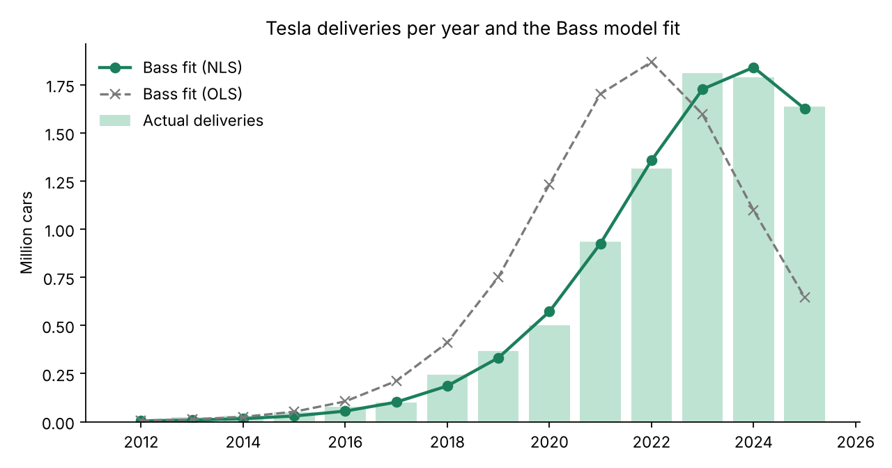
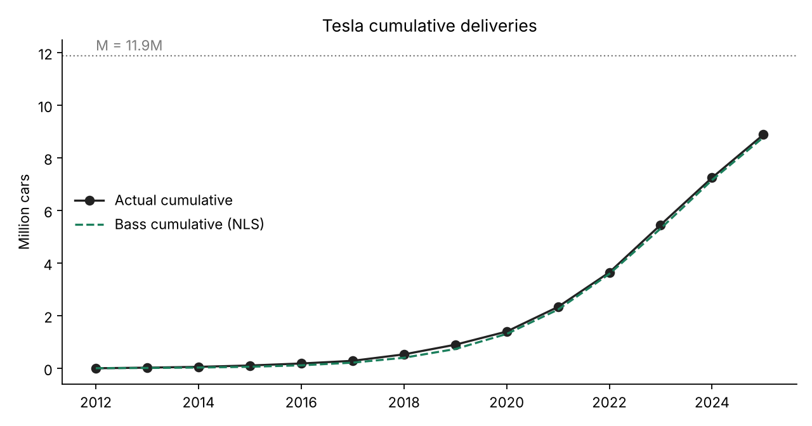
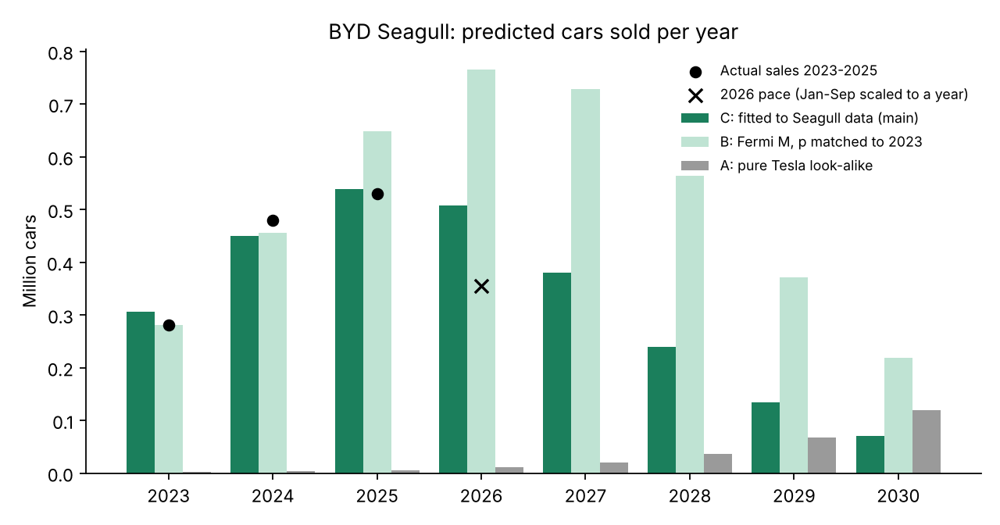
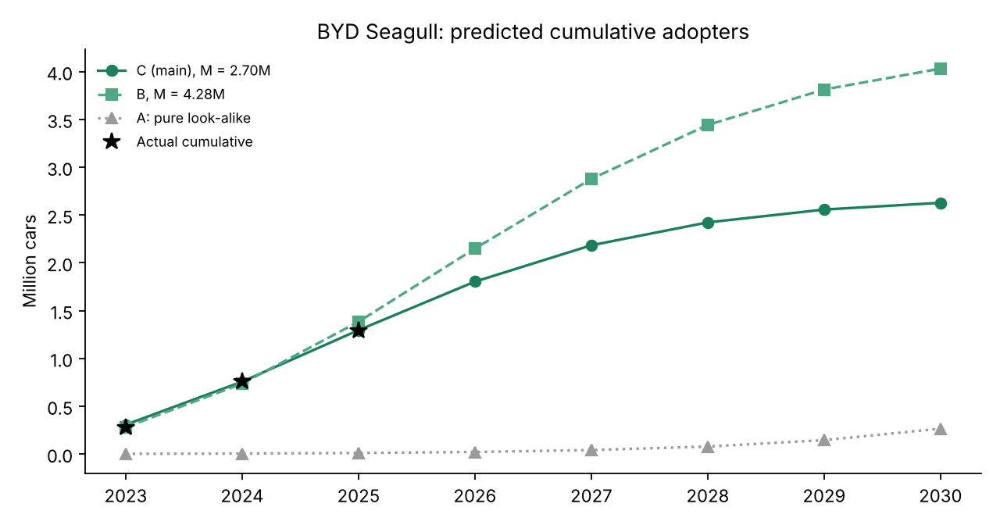

# 1. Chosen innovation

I chose the **BYD Seagull**, which is in the Transportation category of TIME's Best Inventions of 2025 [1].

Link: <https://time.com/collections/best-inventions-2025/7318540/byd-seagull/>

The Seagull is a small, cheap electric car made by the Chinese company BYD. It launched in China on 27 April 2023 for under CN¥90,000 (about \$12,000) [2], and the 2025 version starts at about \$9,650 [3]. That is cheaper than many gasoline cars. Outside China it is sold under other names: Dolphin Mini in Latin America, Dolphin Surf in Europe and Atto 1 in Southeast Asia and Australia [2]. It also won the 2025 World Urban Car award [4]. What makes it an innovation to me is not a single new feature, but that it makes electric cars affordable for normal people.

# 2. Look-alike innovation

As the look-alike I picked **Tesla**, using Tesla's yearly car deliveries from 2012 to 2025.

I first thought about other cheap Chinese EVs like the Wuling Hongguang Mini EV, but their sales data was messy and different sources gave different numbers. Tesla is the better comparison, for these reasons:

- **Functionality:** both are battery electric cars that you charge at home or at a station instead of filling with gasoline.
- **Technology:** both are built on the same main ideas: a lithium-ion battery pack, an electric motor and a lot of software in the car.
- **Market impact:** Tesla is the company that made people take electric cars seriously, and it became the world's best-known EV brand. BYD is now doing the next step: making EVs cheap enough for the mass market.

The big difference is the price. Teslas cost several times more than a Seagull, and Tesla started as a luxury brand. Because of this, I expect people to adopt the two in a different way at the beginning, which I discuss in Section 5.

# 3. Historical data

Since Statista only works on AUA Wi-Fi, I used Tesla's own delivery reports, which Tesla publishes every quarter [5][6].

| Year | Tesla deliveries | Year | Tesla deliveries |
|---|---|---|---|
| 2012 | 2,650 | 2019 | 367,500 |
| 2013 | 22,477 | 2020 | 499,647 |
| 2014 | 31,655 | 2021 | 936,172 |
| 2015 | 50,580 | 2022 | 1,313,851 |
| 2016 | 76,230 | 2023 | 1,808,581 |
| 2017 | 101,312 | 2024 | 1,789,226 |
| 2018 | 245,240 | 2025 | 1,636,129 |

The file is `data/tesla_deliveries.csv`. Tesla's sales peaked in 2023 and went down in 2024 and 2025, so the data shows the whole Bass shape: slow start, fast growth and then a decline. One limitation is that deliveries count cars, not people, so someone who buys a second Tesla is counted twice.

I also collected the real Seagull sales, to use for the forecast (Section 5):

| Year | Seagull sales | Note |
|---|---|---|
| 2023 | 280,217 | launched end of April, so about 8 months [2] |
| 2024 | 479,294 | [2] |
| 2025 | 529,537 | [7] |
| 2026, Jan–Sep | 265,901 | down 33% compared to the same months of 2025 [8] |

# 4. Estimating p, q and M for Tesla

The Bass model from class [9]:
$$F(t) = \frac{1-e^{-(p+q)t}}{1+\frac{q}{p}e^{-(p+q)t}}, \qquad \text{adopters in year } t = M\,[F(t)-F(t-1)]$$

where *p* is the coefficient of innovation, *q* is the coefficient of imitation and *M* is the market potential. For Tesla, t = 1 is 2012.

I estimated the parameters with the two methods from the lecture: non-linear least squares (NLS, like `nls()` in R) and Bass's original regression (OLS), $a(t) = \beta_0 + \beta_1 A(t-1) + \beta_2 A(t-1)^2$.

| Method | p | q | M (million cars) | Peak t\* | R² |
|---|---|---|---|---|---|
| NLS | 0.00028 | 0.625 | 11.88 | 12.3 (2023–2024) | 0.997 |
| OLS | 0.00039 | 0.726 | 10.41 | 10.4 (2021–2022) | 0.53 |

NLS fits almost perfectly (R² = 0.997), and its peak $t^* = \ln(q/p)/(p+q) = 12.3$ lands between 2023 and 2024, which is exactly when Tesla's sales really peaked. OLS puts the peak about two years too early, so I use the NLS results. This agrees with Srinivasan and Mason, who showed that NLS usually works better than OLS for the Bass model [10].

{width=85%}

What the numbers mean:

- **p = 0.00028 is extremely small**, much smaller than the usual value of around 0.03 [11]. This makes sense, because at first almost nobody bought a Tesla "on their own". It was an expensive niche car, and people waited to see if electric cars really worked.
- **q = 0.625 is high** (the usual value is about 0.38 [11]). Almost all of Tesla's growth came from imitation: people saw Teslas on the street, rode in a friend's car and heard others talk about them.
- **M = 11.9 million** means Tesla, with its current car lineup, has already reached about three-quarters of its potential (8.9 million cars delivered by 2025). This fits with the fact that its sales are now falling.

{width=85%}

# 5. Predicting the diffusion of the BYD Seagull

For the Seagull, t = 1 is 2023, the year it launched. I made three scenarios.

**Scenario A: pure look-alike** (p and q from Tesla, M from my Fermi estimate in Section 7). This fails completely. It predicts only about 2,000 Seagulls in 2023, when the real number was 280,000. The reason is that Tesla's tiny p comes from a luxury start-up in 2012, but the Seagull came in 2023 from the world's biggest EV maker, into a market where electric cars were already normal. In China almost half of all new cars sold in 2024 were electric [12]. So the Seagull didn't need years of imitation to get started, and its p must be much higher.

**Scenario B: Fermi M, with p matched to 2023.** I keep q from Tesla and M from the Fermi estimate, and choose p so that 2023 matches the real sales. This gives p = 0.049. It predicts 2024 well (5% too low), but 2025 is 22% too high.

**Scenario C: q from Tesla, p and M fitted to the real Seagull data (main forecast).** Because the Seagull already has three years of sales, I let the data decide p and M. I kept q = 0.625 fixed from Tesla, since three data points are not enough to estimate all three parameters. The fit gave **p = 0.088 and M = 2.70 million cars**. This matches 2024 within 6% and 2025 within 2%.

I trust Scenario C the most, because it uses information from both the look-alike and the Seagull itself, and it fits the real numbers best.

| Year | Actual | C: new (million) | C: cumulative | B: new | B: cumulative | A: new |
|---|---|---|---|---|---|---|
| 2023 | 0.280 | 0.307 | 0.307 | 0.280 | 0.280 | 0.002 |
| 2024 | 0.479 | 0.450 | 0.757 | 0.456 | 0.736 | 0.003 |
| 2025 | 0.530 | **0.539** | 1.296 | 0.648 | 1.384 | 0.006 |
| 2026 | | 0.507 | 1.803 | **0.765** | 2.149 | 0.011 |
| 2027 | | 0.380 | 2.183 | 0.729 | 2.878 | 0.020 |
| 2028 | | 0.239 | 2.423 | 0.564 | 3.442 | 0.037 |
| 2029 | | 0.134 | 2.557 | 0.371 | 3.813 | 0.067 |
| 2030 | | 0.071 | 2.628 | 0.219 | 4.031 | 0.120 |

{width=85%}

{width=85%}

**Checking with 2026 data.** For January to September 2026, Scenario C predicts about 380,000 cars (75% of its 2026 number), Scenario B about 574,000, and the real number was 265,901 [8]. Both are too high, but C is much closer. The real drop is faster than the model predicts. I think there are a few reasons:

- The second-generation Seagull was announced in 2026 and pre-orders opened in October [8], so some people probably waited for the new model.
- There is a lot of competition from other cheap EVs in China.
- The Bass model doesn't include price changes, subsidies or new models.

# 6. Scope: global

I chose to model the Seagull worldwide, not only in China:

- It is sold in many countries under different names [2], and it is now even built in Brazil and Indonesia [2].
- Exports are growing fast. In 2025 only about 311,000 of the 530,000 Seagulls were made in China [2]. If I modeled only China, I would miss around 40% of the sales.
- The sales numbers BYD reports are worldwide totals [7], and Tesla's deliveries are worldwide too, so the look-alike and the new product are measured the same way.

# 7. Market potential (Fermi estimate) and adopters by period

Here is my Fermi estimate of M, which I used in Scenarios A and B and to check Scenario C:

| Step | Value | Source |
|---|---|---|
| Electric cars sold worldwide per year (2024) | 17 million | IEA [12] |
| × share that are small, cheap city cars | 12% → 2.04 million/year | my assumption |
| × Seagull's share of that segment | 30% → 0.61 million/year | my assumption |
| × years the Seagull stays on sale | 7 years | my assumption |
| **M** | **≈ 4.3 million cars** | |

How I chose the assumptions: in 2024 the Seagull alone sold 0.48 million cars, which is about 2.8% of all EVs in the world. My 12% × 30% = 3.6%, so it is in the same range. Seven years is a normal lifetime for a car model, including updates.

The data-based estimate in Scenario C (M = 2.7 million) is lower than my Fermi guess (4.3 million). With the 2026 sales dropping, I think the real M for this generation is closer to 2.7 million. By September 2026 about 1.55 million Seagulls had been sold in total [8], so in Scenario C the car has already reached more than half of its potential.

**Adopters by period (main scenario C):** around 0.51 million in 2026 and 0.38 million in 2027, then quickly fewer, about 2.6 million in total by 2030. The full yearly table for all scenarios is above and in `data/seagull_forecast.csv`.

**Sensitivity to q.** I borrowed q from Tesla, but the Seagull's word-of-mouth effect could be weaker or stronger, so I refit p and M with q 20% lower and 20% higher:

| q | M (million) | p | 2026 sales (million) | Cumulative by 2030 | Peak year |
|---|---|---|---|---|---|
| 0.500 | 3.55 | 0.072 | 0.58 | 3.28 | 2026 |
| 0.625 | 2.70 | 0.088 | 0.51 | 2.63 | 2025 |
| 0.751 | 2.28 | 0.095 | 0.45 | 2.26 | 2025 |

So the total market changes quite a lot (2.3 to 3.6 million), but in every case the Seagull's sales peak in 2025 or 2026 and then go down.

# 8. Conclusion

I used Tesla as the look-alike for the BYD Seagull. For Tesla I got p = 0.00028, q = 0.625 and M = 11.9 million cars, with a very good fit. Simply copying Tesla's parameters didn't work for the Seagull, because cheap EVs entered a market that already trusted electric cars, so people bought them much faster. Keeping Tesla's q and fitting p and M to the Seagull's real sales gives p = 0.088 and M = 2.7 million. In this forecast, sales peak in 2025 at about 0.54 million and the total reaches about 2.6 million by 2030. The 2026 numbers so far show an even faster decline, probably because of the new second-generation model and strong competition.

**Limitations:**

- Deliveries and sales count cars, not people.
- 2023 is only about 8 months of Seagull sales, so the first period is shorter than the others.
- My Fermi assumptions (12%, 30%, 7 years) are guesses, and q is borrowed from Tesla.
- The basic Bass model doesn't include price, subsidies, competition or new generations. The second-generation Seagull could start a new adoption curve, which would need a model with generations (like Norton–Bass).

# References

[1] TIME. (2025, October 9). *BYD Seagull: The Best Inventions of 2025*. <https://time.com/collections/best-inventions-2025/7318540/byd-seagull/>

[2] Wikipedia. *BYD Seagull* (launch, prices, export names, production by year and country). <https://en.wikipedia.org/wiki/BYD_Seagull>

[3] CnEVPost. (2024, August 1). *BYD launches 2025 Seagull with unchanged starting price of \$9,650*. <https://cnevpost.com/2024/08/01/byd-launches-2025-seagull/>

[4] CleanTechnica. (2025, April 30). *BYD Dolphin Mini secures World Urban Car award*. <https://cleantechnica.com/2025/04/30/byd-dolphin-mini-the-car-the-us-will-never-have-secures-world-urban-car-award/>

[5] EV Seekers. *Tesla sales by year* (compiled from Tesla's quarterly delivery reports). <https://evseekers.com/tesla-sales-by-year/>

[6] Tesla, Inc. (2026, January 2). *Tesla Fourth Quarter 2025 Production, Deliveries & Deployments*. <https://ir.tesla.com/press-release/tesla-fourth-quarter-2025-production-deliveries-deployments>

[7] CnEVPost. (2026, January 3). *BYD Dec 2025 sales breakdown*. <https://cnevpost.com/2026/01/03/byd-dec-2025-sales-breakdown/>

[8] CnEVPost. (2026, October 9). *BYD opens pre-orders for larger second-gen Seagull ahead of launch this year* (includes 2026 monthly Seagull sales). <https://cnevpost.com/2026/10/09/byd-opens-pre-orders-second-gen-seagull/>

[9] Bass, F. M. (1969). A new product growth for model consumer durables. *Management Science, 15*(5), 215–227.

[10] Srinivasan, V., & Mason, C. H. (1986). Nonlinear least squares estimation of new product diffusion models. *Marketing Science, 5*(2), 169–178.

[11] Sultan, F., Farley, J. U., & Lehmann, D. R. (1990). A meta-analysis of applications of diffusion models. *Journal of Marketing Research, 27*(1), 70–77.

[12] International Energy Agency. (2025). *Global EV Outlook 2025: Executive summary*. <https://www.iea.org/reports/global-ev-outlook-2025/executive-summary>
